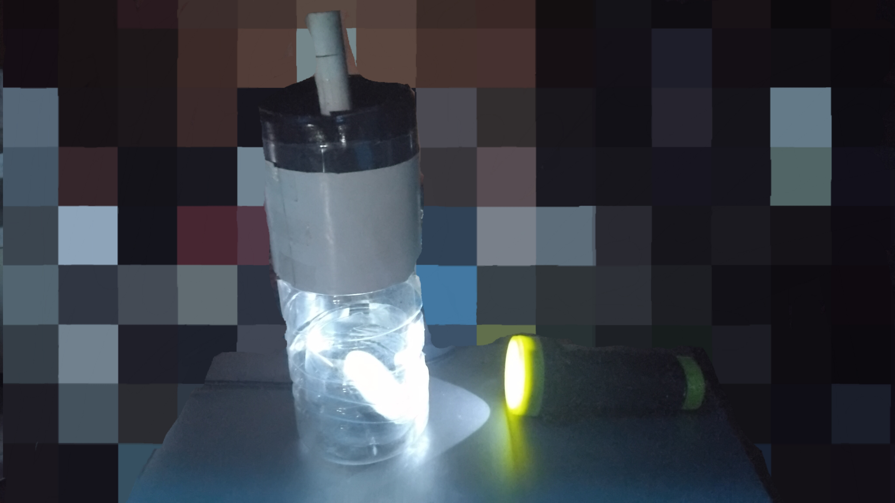
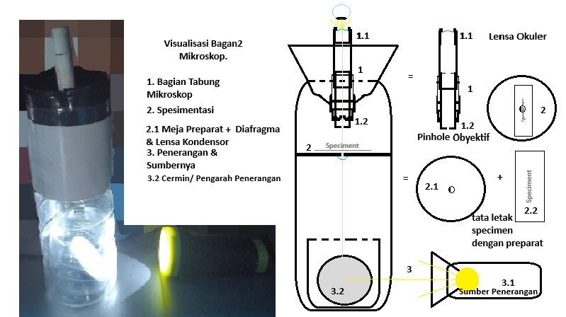

## Point Penting

lem epoksi

lilin bening

kelereng bening

Pentingnya lensa kondensor dan diafragma.

## Abstrak

Membuat Mikrokop _do it yourself (_DIY_)_ berbasis tanpa tetes air.

Tujuan: trobosan kecil dalam menangani mekanisme penyebaran dan pengaruh fase nyamuk secara holistik.

Untuk pengaturan kalibrasi sudah ditentukan dari diafragma mikroskop.

## Bagan bagan Mikroskop

## Gambar

Hubungan antara Lensa Kondensor, Meja Preparat, dan Lensa Objektif (Kondensor Substage | Panduan Anatomi Mikroskop | Evident)

## Hasil Sementara

## Hasil tetap

## Kesimpulan

## Pranala
